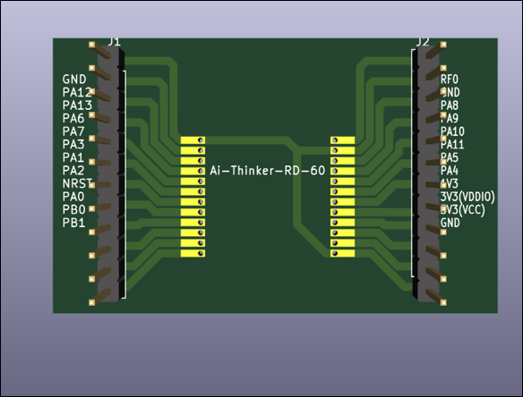
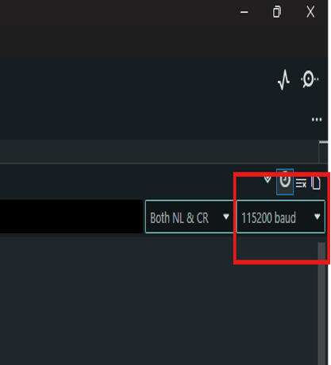

# Détection humaine avec le radar AI-Thinker RD-60

Prototype de détection de mouvements humains destiné à la surveillance d’un espace agricole. Le radar transmet ses données de détection à une carte de test, où elles sont observées sous forme de messages série et de points radar.

> **État du projet : prototype expérimental, travaux en pause.** La liaison entre le radar et LoRa n’a pas encore été réalisée. Les essais LoRa décrits ici sont des essais séparés entre deux modules Dragino LA66 en mode pair-à-pair (P2P).

## Objectif

Le projet explore l’emploi du radar millimétrique AI-Thinker RD-60 pour repérer une présence ou un mouvement humain dans une zone agricole et, à terme, transmettre un journal de détection à distance.

L’usage envisagé autoriserait le passage des animaux tout en signalant les intrusions humaines. **La distinction entre humains et animaux n’a pas été validée par des essais sur des animaux** : elle reste donc une exigence à vérifier et n’est pas présentée comme une performance démontrée.

Le RD-60 est un module radar millimétrique 60 GHz. AI-Thinker documente des fonctions de détection de mouvement humain et plusieurs firmwares, dont un firmware de mesure précise jusqu’à 8 m et un firmware de visualisation de nuage de points. Les performances dépendent du firmware, de la cible et des conditions d’essai. [Documentation officielle RD-6x](https://docs.ai-thinker.com/en/rd-6x/) · [Fiche technique du kit RD-60](https://docs.ai-thinker.com/_media/rd-60-kit_v2.0.0_specification_20250217.pdf)

## Architecture envisagée

1. Le RD-60 détecte une cible et produit des données radar.
2. Un microcontrôleur lit les données et identifie l’événement à journaliser.
3. Une liaison radio transmet le journal à un récepteur distant.
4. Une alimentation adaptée permet le fonctionnement autonome sur le terrain.

Seules les étapes de détection, d’observation des données et certains essais radio séparés ont été explorés à ce stade. L’envoi des journaux du RD-60 par LoRa/LoRaWAN et l’alimentation autonome restent à réaliser.

## Réalisations

### Adaptation du module et essais radar

Le RD-60 est un composant CMS dont le pas de broches de 1,27 mm ne correspond pas directement à celui d’une plaque d’essai standard de 2,54 mm. Une carte adaptatrice a été conçue et fabriquée pour faciliter les premiers essais sur plaque d’essai.

Des essais ont été conduits avec une Arduino Mega. Le module a été flashé avec l’outil du fabricant et plusieurs firmwares ont été explorés, notamment la visualisation des points radar et un firmware de mesure précise. Des personnes ont marché dans la zone surveillée pendant les essais en laboratoire ; des données et coordonnées de points ont été observées sur le moniteur série et dans une visualisation.

Avec le **Standard Point Cloud FW**, une détection a été observée jusqu’à 10 m pendant les essais du projet. Il s’agit d’une observation expérimentale rapportée par l’auteur, et non d’une portée garantie : la cible, l’environnement et le protocole peuvent influer sur le résultat. Elle est à distinguer de la portée annoncée pour d’autres firmwares dans la documentation du fabricant. Le radar a également permis d’observer des mouvements millimétriques selon l’usage documenté ; une caractérisation métrologique complète reste à faire.

### Carte d’interface et programmation

Une seconde carte, distincte de l’adaptateur du capteur, a été conçue pour les essais d’interface et de programmation du module. Les schémas et le routage ont été réalisés dans KiCad, puis des fichiers Gerber ont été exportés. Des cartes de test ont été usinées et assemblées.

La conception décrite par l’auteur utilise deux circuits CH340G pour les interfaces série nécessaires aux essais de programmation et à l’observation des journaux. Les fichiers KiCad natifs fournis ici concernent la carte adaptatrice RD-60. Ils comprennent le schéma, le circuit imprimé et le fichier de projet. Les fichiers de conception natifs de la carte de programmation et sa nomenclature détaillée restent à ajouter.

Une documentation officielle AI-Thinker a été traduite et adaptée pour faciliter les essais. Ce dépôt en présente le contexte et les résultats ; il ne redistribue pas la documentation traduite.

### Essais LoRa séparés

Deux modules Dragino LA66 ont été utilisés pour des essais radio en mode pair-à-pair (P2P), notamment des essais de portée et de commandes à distance. **Ces essais n’étaient pas reliés au RD-60 : aucun journal radar n’a été envoyé par LoRa ou LoRaWAN dans le cadre des validations rapportées ici.** Le LA66 prend en charge LoRaWAN et le mode P2P, qui sont deux modes distincts. [Documentation Dragino LA66](https://wiki.dragino.com/docs/LoRaWAN-End-Node/lora-modules-accessories/la66-module/) · [Guide du firmware P2P LA66](https://docs.dragino.com/docs/LoRaWAN-General-Configuration/instruction-for-la66-peer-to-peer-firmware/)

## Résultats et limites actuels

- Détection et observation de données radar testées en laboratoire.
- Journaux série reçus pendant des essais de marche devant le capteur.
- Visualisation de points radar réalisée à partir de données observées.
- Portée jusqu’à 10 m rapportée dans le cadre des essais du projet ; protocole et conditions détaillés à compléter.
- Essais radio P2P réalisés séparément avec deux modules LA66.
- Sélectivité humains/animaux non validée.
- Transmission des événements du radar par LoRaWAN non réalisée.
- Dimensionnement énergétique, intégration finale avec ESP32 et PCB final non réalisés.
- Le projet a été mis en pause avant l’intégration complète.

## Galerie

Les images originales fournies sont conservées dans [picture/](picture/). Quelques preuves représentatives :

### Adaptateur et module radar

### Conception KiCad et cartes

### Essais et visualisation

## Arborescence

- `picture/` : photographies, captures et rendus visuels du projet.
- `KiCad/` : schéma, circuit imprimé et projet KiCad de la carte adaptatrice RD-60.
- `PDF/` : emplacement prévu pour les fiches techniques et documents PDF autorisés à être partagés. Aucun PDF n’était présent dans les éléments reçus lors de la préparation de ce dépôt.

## Suites envisagées

1. Finaliser la lecture et le décodage des trames du RD-60.
2. Reprendre la conception autour d’un ESP32 et du PCB final.
3. Caractériser la détection avec un protocole reproductible, y compris la réponse à des mouvements humains et aux animaux visés par le cas d’usage.
4. Réaliser et documenter le dimensionnement énergétique.
5. Intégrer la transmission des journaux radar sur LoRaWAN et vérifier la chaîne complète de bout en bout.
6. Documenter les résultats, les conditions d’essai et les limites de détection.

## Crédits et références

- Radar RD-60 : AI-Thinker, [documentation officielle RD-6x](https://docs.ai-thinker.com/en/rd-6x/).
- Modules radio LA66 : Dragino, [documentation officielle](https://wiki.dragino.com/docs/LoRaWAN-End-Node/lora-modules-accessories/la66-module/).
- Conception électronique et essais : réalisés par l’auteur du projet.

